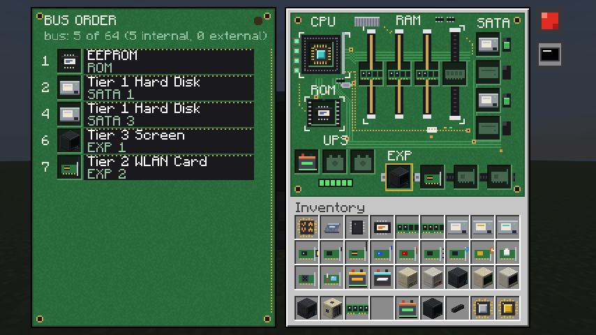

# Modular Computers

**Build computers in Minecraft: assemble the parts, then program them in Lua.**



Modular Computers is a mod for Fabric and NeoForge. Put a CPU, memory and an EEPROM in a case, add a
disk and a screen, and boot **mcos**, a Linux-like operating system on a disk you craft. Then
automate your world with redstone, sensors and pistons, connect computers into networks, or just
learn how a computer really works.

**[Read the manual](https://payonel.github.io/modularcomputers/)**: tutorials, every block and
item, every device's methods, and the man page of every program.

## What it is

- **A Lua that can be frozen and saved.** Programs run on LungoLua and StyxLua,
  a pure-Java port of Lua 5.5 with CPU and memory budgets, preemptive freezing and persistence, and
  no native code. A running computer is saved with the world and resumes mid-run.
- **Real parts.** Cases in three tiers, CPUs, memory, EEPROMs, disks, cards in slots, cables, hubs,
  batteries and screens. Devices sit on one bus and wake a program with an interrupt.
- **An operating system.** mcos has a shell, a filesystem, processes, sockets, services, remote
  shells and 53 programs, each with a man page. Its disks are real files in your world save.
- **Networks.** Wired and wireless network cards, UDP and TCP in mcos, and Wake-on-LAN.
- **Real terminals.** VT102 and xterm screens with color, scrollback, resizing and sixel graphics.

## Install

Not released yet: build it from source. You need nothing but Git; Gradle downloads Java 25.

```sh
git clone https://github.com/payonel/modularcomputers.git
cd modularcomputers
./gradlew build      # the jars: fabric/build/libs/, neoforge/build/libs/
```

For Minecraft 26.3, on Fabric (Loader 0.19.5 or newer, Fabric API 0.162.0+26.3) or NeoForge
(26.3.0.95). See [Installing](https://payonel.github.io/modularcomputers/install/).

## Building and testing

```sh
./gradlew build      # compile and unit tests (seconds; doesn't start Minecraft)
./gradlew testAll    # everything: server game tests on both loaders, headless client tests
```

`common/` holds the mod, written against the plain game; `fabric/` and `neoforge/` are each loader's
entry point. Test layers and the headless setup are in [.agents/TESTING.md](.agents/TESTING.md), and
version numbers in [.agents/VERSIONING.md](.agents/VERSIONING.md).

## Standing on OpenComputers

Modular Computers is built on what [OpenComputers](https://github.com/MightyPirates/OpenComputers)
worked out: computers you assemble from parts and program in Lua, a network of devices, power that
matters, a persistent machine that survives a restart, and an operating system to make it all
usable. Those ideas were solved there, by the MightyPirates team and its many contributors, and
this mod would not exist without them. payonel, who maintains it, is one of OpenComputers'
original authors.

This is a new mod written from scratch, with its own Lua engine and its own design. It shares none
of OpenComputers' code, and credits it for the idea and for years of proving that it works.

## License

[MIT](LICENSE).
